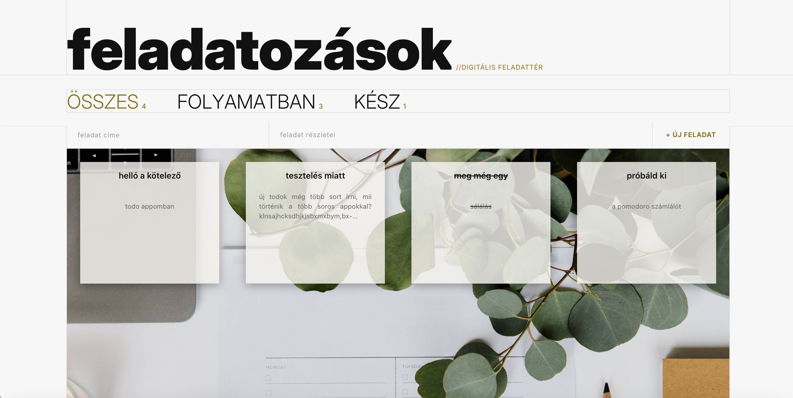
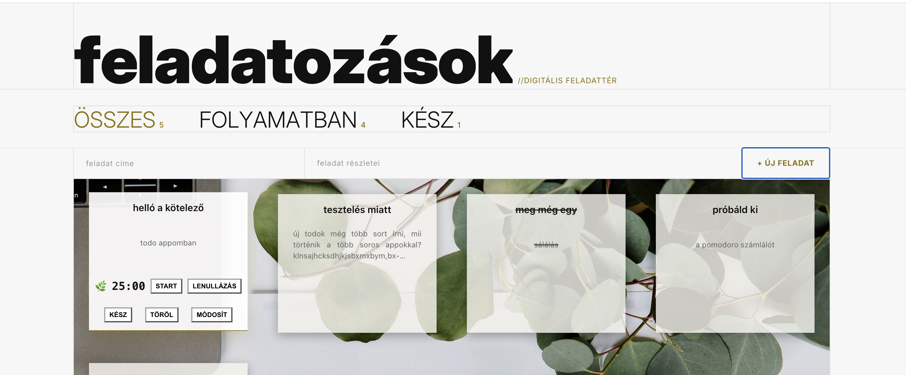
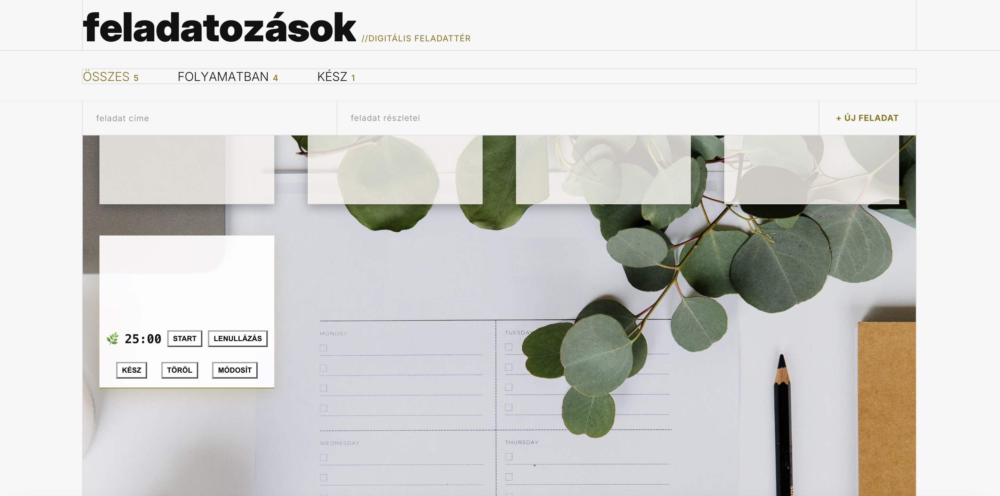
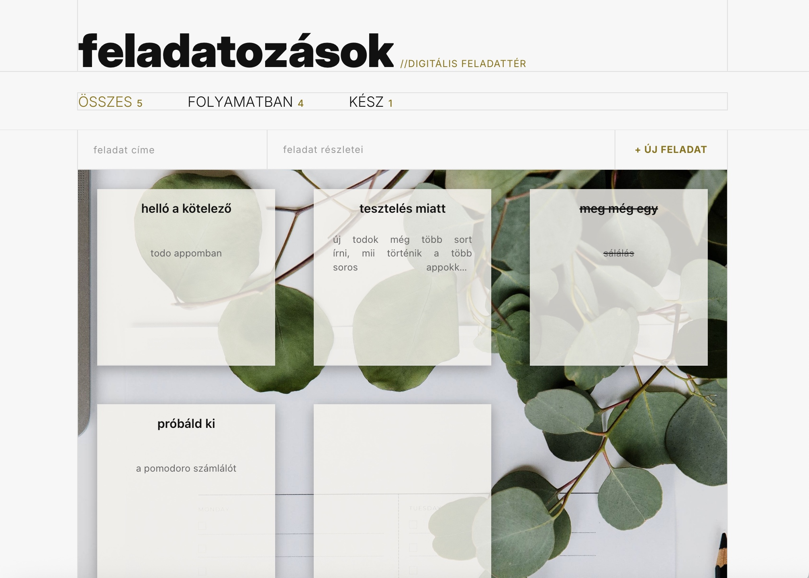

# 📝 Full-Stack To-Do & Pomodoro App

Egy modern, reszponzív feladatkezelő webalkalmazás beépített Pomodoro időzítővel.  
A modern, fully responsive task management web application with an integrated Pomodoro timer.

---

## 🇭🇺 Magyar Leírás

### 📸 Képernyőképek 

#### 📊 Áttekintés és Funkciók
| Főoldal | Feladat hozzáadás, törlés & Pomodoro | Feladat frissítése |
| :---: | :---: | :---: |
|  |  |  |

#### 📱 Mobil- és Mobil-barát nézetek
| Reszponzív nézet 1 | Reszponzív nézet 2 |
| :---: | :---: |
|  |  |

---

### ✨ Főbb funkciók

- ➕ Új to-do feladatok létrehozása, szerkesztése és törlése
- ⏱️ Beépített Pomodoro időzítő a hatékony munkavégzéshez
- 📱 Teljesen reszponzív kialakítás (mobil, tablet és asztali nézet)
- ⚡ Gyors, letisztult felhasználói felület

---

## 🇬🇧 English Description

### 📸 Screenshots

#### 📊 Overview & Features
| Main View | Add, Delete & Pomodoro Timer | Update Task |
| :---: | :---: | :---: |
|  |  |  |

#### 📱 Responsive Layouts
| Responsive View 1 | Responsive View 2 |
| :---: | :---: |
|  |  |

---

### ✨ Features

- ➕ Create, edit, update, and delete to-do items
- ⏱️ Integrated Pomodoro timer for enhanced productivity
- 📱 Fully responsive UI (Mobile, Tablet, Desktop)
- ⚡ Fast and clean user experience

---

## 🛠️ Technológia / Tech Stack

- **Frontend:** React / HTML5 / CSS3 / JavaScript
- **Backend:** Node.js / Express.js
- **Deployment:** Render.com / GitHub

---

## 🚀 Helyi futtatás / Local Setup

1. **Repó klónozása / Clone repository:**
   ```bash
   git clone [https://github.com/nemevidplus/minimalist-todo-pomodoro-app.git](https://github.com/nemevidplus/minimalist-todo-pomodoro-app.git)
   cd minimalist-todo-pomodoro-app

   🩷

   